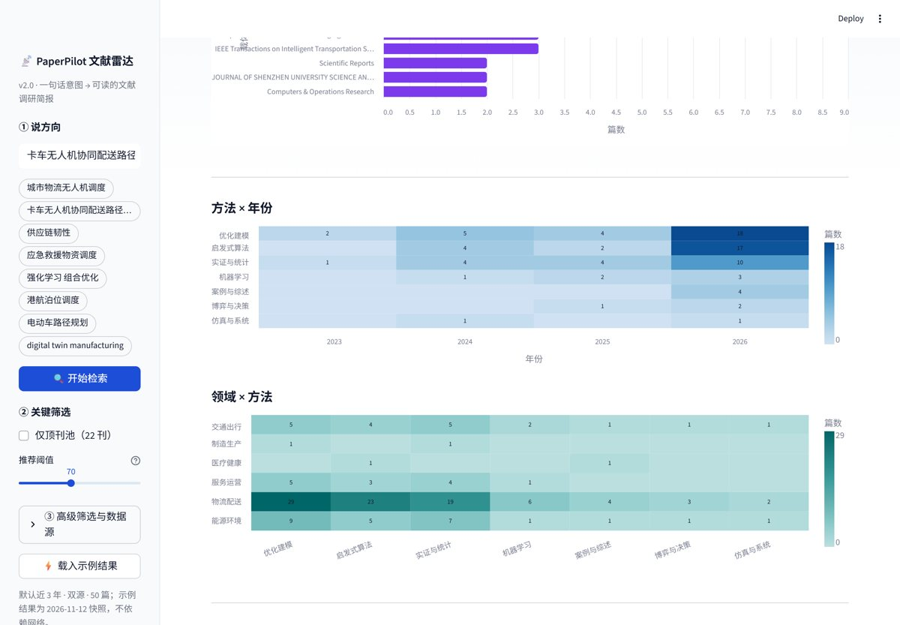

# PaperPilot 文献雷达 · Streamlit 在线工作台 v3

> 输入一句研究意图，得到一份可读、可复现的文献调研简报。
> 意图解析 → OpenAlex + Crossref 双源检索 → BM25 五维评分 → 领域洞察 → 报告与引用导出。

一个面向科研入门者的文献调研工作台。把「找文献 → 判断值不值得读 → 整理成简报」压缩成一次检索。


---

## 它做什么

| 阶段 | 能力 |
| --- | --- |
| 意图解析 | 中文/英文研究意图 → 英文学术检索式 + 中文主题标签；内置约 150 个学术术语，最长匹配，不编造概念 |
| 多源检索 | OpenAlex 全网文献 + Crossref 出版商元数据并行召回；DOI/标题去重 + 保守近重复合并，保留「双源命中」证据 |
| 五维打分 | 相关 0.40 / 新颖 0.20 / 质量 0.15 / 方法 0.15 / 启发 0.10；相关性用 BM25 + 检索词覆盖率 + OpenAlex relevance_score + 召回位次 |
| 证据校验 | 标题、年份、载体/DOI 硬校验；缺关键项不进入自动推荐，摘要缺失会标注 |
| 领域洞察 | 年份趋势、方法格局、高频载体、方法 × 年份热力图、领域 × 方法热力图、选题缺口线索 |
| 开放获取 | 每篇标注 OA 状态，能拿到直链时提供「直达 PDF（OA）」，不绕过付费墙 |
| 报告与导出 | Markdown 调研简报 + BibTeX / RIS / CSV / JSON；检索式、筛选条件、来源与耗时全部可复现 |
| 分享与兜底 | 检索条件写入 URL，可分享可复现链接；内置 `demo_snapshot.json` 示例快照，网络/配额异常时也能完整演示 |
| AI 增强（可选） | 自带任意 OpenAI 兼容 Key：AI 改写检索式、生成逐篇推荐理由、润色调研摘要 |



---

## 数据来源与合规

- 数据源：**OpenAlex**（开放学术索引，CC0）与 **Crossref**（出版商公开元数据）。
- 只读取公开元数据，标注开放获取状态；**不做任何绕过付费墙的下载**。
- 可选：在侧边栏填入自己的 OpenAlex API Key 提高配额；填入 LLM Key 启用 AI 增强。Key 只存在当前会话内存，不写入磁盘。

---

## 本地运行

```bash
pip install -r requirements.txt
streamlit run app.py
```

浏览器打开提示的地址（默认 <http://localhost:8501>）。

### 运行测试

```bash
python -m unittest discover -s tests -v
```

44 项单元测试覆盖：文本处理、检索过滤、双源归一化与去重、近重复合并、BM25 评分边界、证据校验、领域/方法矩阵、洞察与报告、四种导出、意图解析，以及 LLM 层的 Mock 服务。

---

## 部署到 Streamlit Community Cloud

1. 把本仓库推到 GitHub（公开仓库最简单）。
2. 打开 <https://share.streamlit.io>，用 GitHub 账号登录并授权。
3. 点 **Create app** → 选本仓库 → Branch 填 `master`（或 `main`）→ Main file path 填 `app.py`。
4. （可选）在 App URL 里自定义子域名。
5. 点 **Deploy**，约 2–3 分钟即可得到 `https://<你的子域名>.streamlit.app` 公开链接。

> `requirements.txt` 只依赖 `streamlit>=1.50,<2` 与 `altair>=5.0`；pandas 由 Streamlit 自带。

### 可复现链接

检索后 URL 会自动带上 `q / window / cite / size / top / oa / th / src` 参数，例如：

```text
https://paperpilot-radar.streamlit.app/?q=卡车无人机协同配送路径规划&window=1095&size=50&top=0&oa=0&th=70&src=openalex,crossref
```

打开即可自动检索并还原筛选条件。

---

## 验证示例

检索主题：`卡车无人机协同配送路径规划`（自动转成 `truck drone collaborative delivery routing`），双源、近 3 年、50 篇、阈值 70。

| 指标 | 数值（本地实测，随数据更新会变） |
| --- | --- |
| OpenAlex 命中 | 1,400 |
| Crossref 命中 | 160,986（原始总量） |
| 本页去重后 | 50 |
| 顶刊篇数 | 17 |
| 开放获取 | 30 |
| 平均被引 | 14 |
| 达标推荐（阈值 70） | 27 |
| 双源并行耗时 | 约 4–8 秒 |

---

## 文件说明

| 文件 | 作用 |
| --- | --- |
| `app.py` | Streamlit 界面：检索条件、结果卡片、领域洞察、调研简报、导出与复现 |
| `core.py` | 核心引擎：归一化、BM25 五维评分、证据校验、领域/方法矩阵、洞察、报告、导出 |
| `sources.py` | 多源检索：OpenAlex / Crossref 并行、归一化、去重、近重复合并 |
| `intent.py` | 意图解析：中英学术术语词典、检索式生成、缩写补全 |
| `llm.py` | 可选 LLM 层：意图解析、推荐理由、摘要润色（OpenAI 兼容协议） |
| `demo_snapshot.json` | 示例快照（2026-11-12），网络/配额异常时的兜底演示 |
| `tests/` | 44 项单元测试（标准库 unittest） |
| `docs/` | README 截图 |
| `.streamlit/config.toml` | 主题与服务器配置 |

---

## 22 刊顶刊池（按 ISSN）

EJOR · COR · Transportation Science · OMEGA · TR Part A/B/C/D/E · Networks ·
Mathematics of OR · Operations Research · Management Science · M&SOM · POM · IJOC ·
IEEE TITS · IEEE TEVC · IEEE TASE · IEEE TCYB · IEEE IoT-J · IEEE TII

OpenAlex 在检索源头按 ISSN 过滤；Crossref 因接口限制在本地按 ISSN 过滤。

---

## 已知局限

- 相关性是 BM25 词频统计，不做语义理解；同义词、缩写与跨语言表达可能漏召回。
- 方法与领域分组基于标题/摘要关键词，存在误判与漏判。
- 近重复合并是保守启发式，仍可能漏掉标题差异较大的预印本/正式版。
- Crossref 的「命中总量」是模糊检索结果，仅作参考；本页以去重后的实际条目为准。
- 所有结论都应回到原文核对，工具不替代阅读。

---

## 许可

MIT License。数据来源 OpenAlex（CC0）与 Crossref 公开元数据。
